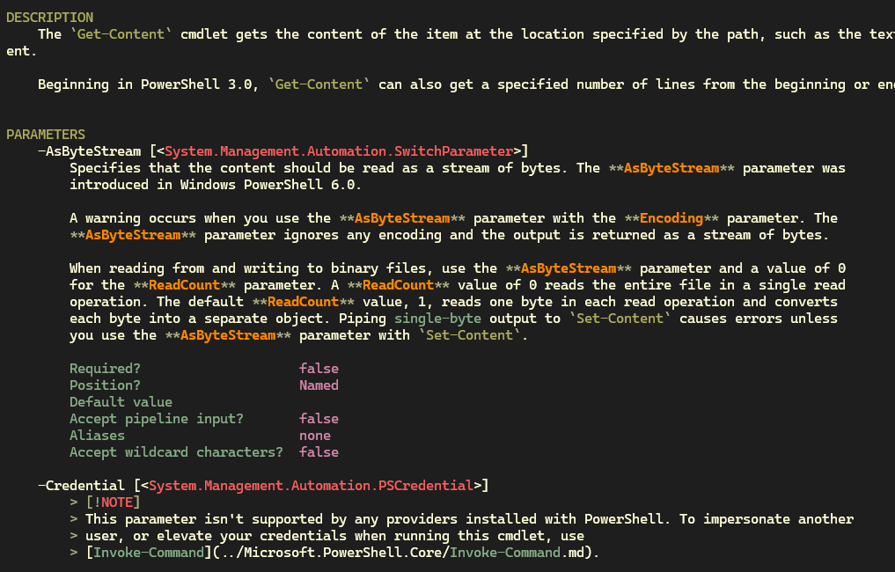

  [Raw Sources / PRs / Local Bundles]
                 │
                 ▼  (1. Inhale & Validate Schemas/Paths)
  [scripts/validate-manifest.sh] ──► Fail-closed if invalid
                 │
                 ▼  (2. Compress + SHA-256 + Immutable Name)
  [scripts/build-bundle.sh]      ──► <bundle>_<ts>_<sha256_short>.tar.zst + .sha256
                 │
                 ▼  (3. One-Way Push to Buckets / Mirrors)
  [.github/workflows/one-way-pipeline.yml]
                 │
                 ├──► Object Bucket / WORM / rclone Remote (Append-Only / Object Lock)
                 └──► Release / Mirror Target (Content-Addressed / Timestamped)
{
  "pipeline_name": "adpbetty-one-way-global-pipeline",
  "owner": "WK Precision Enterprise LLC",
  "immutability_mode": "append_only_content_addressed",
  "allow_reverse_sync": false,
  "targets": [
    {
      "name": "primary-object-bucket",
      "type": "rclone_remote",
      "remote_path": "worm-bucket:adpbetty-immutable/releases",
      "overwrite_existing": false,
      "verify_after_push": true
    },
    {
      "name": "secondary-regional-mirror",
      "type": "rclone_remote",
      "remote_path": "mirror-remote:adpbetty-immutable/mirrors",
      "overwrite_existing": false,
      "verify_after_push": true
    },
    {
      "name": "local-custody-vault",
      "type": "local_dir",
      "local_path": "/var/backups/adpbetty-immutable",
      "overwrite_existing": false,
      "verify_after_push": true
    }
  ]
}
#!/usr/bin/env bash
set -euo pipefail

DIST_DIR="${1:-dist}"
TARGETS_CONFIG="${2:-pipelines/one-way-targets.json}"

for cmd in jq sha256sum; do
  if ! command -v "$cmd" >/dev/null 2>&1; then
    echo "Error: required command '$cmd' not found." >&2
    exit 2
  fi
done

if [[ ! -d "$DIST_DIR" ]]; then
  echo "Error: dist directory '$DIST_DIR' does not exist." >&2
  exit 1
fi

if [[ ! -f "$TARGETS_CONFIG" ]]; then
  echo "Error: targets config '$TARGETS_CONFIG' not found." >&2
  exit 1
fi

ALLOW_REVERSE="$(jq -r '.allow_reverse_sync // false' "$TARGETS_CONFIG")"
if [[ "$ALLOW_REVERSE" != "false" ]]; then
  echo "Error: one-way pipeline requires allow_reverse_sync=false." >&2
  exit 1
fi

# Verify local dist artifacts before pushing anywhere
(
  cd "$DIST_DIR"
  sha256sum -c ./*.sha256 --quiet
)

mapfile -t ARTIFACTS < <(find "$DIST_DIR" -maxdepth 1 -type f \( -name "*.tar.zst" -o -name "*.sha256" -o -name "*.manifest" \) | sort)
if [[ "${#ARTIFACTS[@]}" -eq 0 ]]; then
  echo "Error: no bundle artifacts found in '$DIST_DIR'." >&2
  exit 1
fi

TARGET_COUNT="$(jq '.targets | length' "$TARGETS_CONFIG")"
for ((i = 0; i < TARGET_COUNT; i++)); do
  t_name="$(jq -r ".targets[$i].name" "$TARGETS_CONFIG")"
  t_type="$(jq -r ".targets[$i].type" "$TARGETS_CONFIG")"
  overwrite="$(jq -r ".targets[$i].overwrite_existing // false" "$TARGETS_CONFIG")"

  if [[ "$overwrite" != "false" ]]; then
    echo "Error: target '$t_name' sets overwrite_existing=true; immutable pipeline forbids overwrites." >&2
    exit 1
  fi

  case "$t_type" in
    rclone_remote)
      remote_path="$(jq -r ".targets[$i].remote_path" "$TARGETS_CONFIG")"
      if command -v rclone >/dev/null 2>&1; then
        echo "Pushing one-way (immutable/no-clobber) to $t_name ($remote_path)..."
        for art in "${ARTIFACTS[@]}"; do
          rclone copyto "$art" "${remote_path}/$(basename "$art")" --ignore-existing --checksum
        done
      else
        echo "Warning: rclone not installed; skipping remote target '$t_name' ($remote_path)." >&2
      fi
      ;;
    local_dir)
      local_path="$(jq -r ".targets[$i].local_path" "$TARGETS_CONFIG")"
      mkdir -p "$local_path"
      echo "Copying one-way (immutable/no-clobber) to $t_name ($local_path)..."
      for art in "${ARTIFACTS[@]}"; do
        dest_file="${local_path}/$(basename "$art")"
        if [[ -e "$dest_file" ]]; then
          echo "Error: immutable artifact already exists at '$dest_file'; refusing overwrite." >&2
          exit 1
        fi
        cp -p "$art" "$dest_file"
      done
      (
        cd "$local_path"
        sha256sum -c ./*.sha256 --quiet
      )
      ;;
    *)
      echo "Error: unsupported target type '$t_type' in '$t_name'." >&2
      exit 1
      ;;
  esac
done

echo "One-way push complete across all $TARGET_COUNT target(s)."
name: adpBetty One-Way Pipeline & Immutable Push

on:
  push:
    branches: [ "main" ]
    tags: [ "v*" ]
  workflow_dispatch:
    inputs:
      push_targets:
        description: "Execute one-way push script to configured targets (true/false)"
        required: false
        default: "false"

permissions:
  contents: read

concurrency:
  group: adpbetty-one-way-${{ github.ref }}
  cancel-in-progress: false

jobs:
  immutable-pipeline:
    runs-on: ubuntu-latest
    timeout-minutes: 15
    steps:
      - name: Checkout adpBetty
        uses: actions/checkout@v4
        with:
          persist-credentials: false

      - name: Install required CLI tools
        run: sudo apt-get update && sudo apt-get install -y --no-install-recommends jq zstd rclone

      - name: Validate targets config and manifests
        run: |
          jq empty pipelines/one-way-targets.json
          chmod +x scripts/validate-manifest.sh scripts/build-bundle.sh scripts/push-one-way.sh
          ./scripts/validate-manifest.sh

      - name: Build immutable bundles and verify integrity
        run: |
          ./scripts/build-bundle.sh
          cd dist
          sha256sum -c ./*.sha256
          zstd -tq ./*.tar.zst

      - name: Upload immutable build artifact
        uses: actions/upload-artifact@v4
        with:
          name: adpbetty-immutable-${{ github.sha }}
          path: dist/*
          retention-days: 90

      - name: One-way push to configured downstream sinks
        if: ${{ inputs.push_targets == 'true' }}
        env:
          RCLONE_CONFIG: ${{ secrets.RCLONE_CONFIG }}
        run: |
          if [[ -n "${RCLONE_CONFIG:-}" ]]; then
            mkdir -p ~/.config/rclone
            printf '%s\n' "$RCLONE_CONFIG" > ~/.config/rclone/rclone.conf
            chmod 600 ~/.config/rclone/rclone.conf
          fi
          ./scripts/push-one-way.sh dist pipelines/one-way-targets.json
chmod +x scripts/validate-manifest.sh scripts/build-bundle.sh scripts/push-one-way.sh
./scripts/validate-manifest.sh
./scripts/build-bundle.sh
./scripts/push-one-way.sh dist pipelines/one-way-targets.json
validate-manifest.shbuild-bundle.shchmod +x scripts/validate-manifest.sh scripts/build-bundle.sh scripts/push-one-way.sh
./scripts/validate-manifest.sh
./scripts/build-bundle.sh
./scripts/push-one-way.sh dist pipelines/one-way-targets.json
name: adpBetty One-Way Pipeline & Immutable Push

on:
  push:
    branches: [ "main" ]
    tags: [ "v*" ]
  workflow_dispatch:
    inputs:
      push_targets:
        description: "Execute one-way push script to configured targets (true/false)"
        required: false
        default: "false"

permissions:
  contents: read

concurrency:
  group: adpbetty-one-way-${{ github.ref }}
  cancel-in-progress: false

jobs:
  immutable-pipeline:
    runs-on: ubuntu-latest
    timeout-minutes: 15
    steps:
      - name: Checkout adpBetty
        uses: actions/checkout@v4
        with:
          persist-credentials: false

      - name: Install required CLI tools
        run: sudo apt-get update && sudo apt-get install -y --no-install-recommends jq zstd rclone

      - name: Validate targets config and manifests
        run: |
          jq empty pipelines/one-way-targets.json
          chmod +x scripts/validate-manifest.sh scripts/build-bundle.sh scripts/push-one-way.sh
          ./scripts/validate-manifest.sh

      - name: Build immutable bundles and verify integrity
        run: |
          ./scripts/build-bundle.sh
          cd dist
          sha256sum -c ./*.sha256
          zstd -tq ./*.tar.zst

      - name: Upload immutable build artifact
        uses: actions/upload-artifact@v4
        with:
          name: adpbetty-immutable-${{ github.sha }}
          path: dist/*
          retention-days: 90

      - name: One-way push to configured downstream sinks
        if: ${{ inputs.push_targets == 'true' }}
        env:
          RCLONE_CONFIG: ${{ secrets.RCLONE_CONFIG }}
        run: |
          if [[ -n "${RCLONE_CONFIG:-}" ]]; then
            mkdir -p ~/.config/rclone
            printf '%s\n' "$RCLONE_CONFIG" > ~/.config/rclone/rclone.conf
            chmod 600 ~/.config/rclone/rclone.conf
          fi
          ./scripts/push-one-way.sh dist pipelines/one-way-targets.json
#!/usr/bin/env bash
set -euo pipefail

DIST_DIR="${1:-dist}"
TARGETS_CONFIG="${2:-pipelines/one-way-targets.json}"

for cmd in jq sha256sum; do
  if ! command -v "$cmd" >/dev/null 2>&1; then
    echo "Error: required command '$cmd' not found." >&2
    exit 2
  fi
done

if [[ ! -d "$DIST_DIR" ]]; then
  echo "Error: dist directory '$DIST_DIR' does not exist." >&2
  exit 1
fi

if [[ ! -f "$TARGETS_CONFIG" ]]; then
  echo "Error: targets config '$TARGETS_CONFIG' not found." >&2
  exit 1
fi

ALLOW_REVERSE="$(jq -r '.allow_reverse_sync // false' "$TARGETS_CONFIG")"
if [[ "$ALLOW_REVERSE" != "false" ]]; then
  echo "Error: one-way pipeline requires allow_reverse_sync=false." >&2
  exit 1
fi

# Verify local dist artifacts before pushing anywhere
(
  cd "$DIST_DIR"
  sha256sum -c ./*.sha256 --quiet
)

mapfile -t ARTIFACTS < <(find "$DIST_DIR" -maxdepth 1 -type f \( -name "*.tar.zst" -o -name "*.sha256" -o -name "*.manifest" \) | sort)
if [[ "${#ARTIFACTS[@]}" -eq 0 ]]; then
  echo "Error: no bundle artifacts found in '$DIST_DIR'." >&2
  exit 1
fi

TARGET_COUNT="$(jq '.targets | length' "$TARGETS_CONFIG")"
for ((i = 0; i < TARGET_COUNT; i++)); do
  t_name="$(jq -r ".targets[$i].name" "$TARGETS_CONFIG")"
  t_type="$(jq -r ".targets[$i].type" "$TARGETS_CONFIG")"
  overwrite="$(jq -r ".targets[$i].overwrite_existing // false" "$TARGETS_CONFIG")"

  if [[ "$overwrite" != "false" ]]; then
    echo "Error: target '$t_name' sets overwrite_existing=true; immutable pipeline forbids overwrites." >&2
    exit 1
  fi

  case "$t_type" in
    rclone_remote)
      remote_path="$(jq -r ".targets[$i].remote_path" "$TARGETS_CONFIG")"
      if command -v rclone >/dev/null 2>&1; then
        echo "Pushing one-way (immutable/no-clobber) to $t_name ($remote_path)..."
        for art in "${ARTIFACTS[@]}"; do
          rclone copyto "$art" "${remote_path}/$(basename "$art")" --ignore-existing --checksum
        done
      else
        echo "Warning: rclone not installed; skipping remote target '$t_name' ($remote_path)." >&2
      fi
      ;;
    local_dir)
      local_path="$(jq -r ".targets[$i].local_path" "$TARGETS_CONFIG")"
      mkdir -p "$local_path"
      echo "Copying one-way (immutable/no-clobber) to $t_name ($local_path)..."
      for art in "${ARTIFACTS[@]}"; do
        dest_file="${local_path}/$(basename "$art")"
        if [[ -e "$dest_file" ]]; then
          echo "Error: immutable artifact already exists at '$dest_file'; refusing overwrite." >&2
          exit 1
        fi
        cp -p "$art" "$dest_file"
      done
      (
        cd "$local_path"
        sha256sum -c ./*.sha256 --quiet
      )
      ;;
    *)
      echo "Error: unsupported target type '$t_type' in '$t_name'." >&2
      exit 1
      ;;
  esac
done

echo "One-way push complete across all $TARGET_COUNT target(s)."
{
  "pipeline_name": "adpbetty-one-way-global-pipeline",
  "owner": "WK Precision Enterprise LLC",
  "immutability_mode": "append_only_content_addressed",
  "allow_reverse_sync": false,
  "targets": [
    {
      "name": "primary-object-bucket",
      "type": "rclone_remote",
      "remote_path": "worm-bucket:adpbetty-immutable/releases",
      "overwrite_existing": false,
      "verify_after_push": true
    },
    {
      "name": "secondary-regional-mirror",
      "type": "rclone_remote",
      "remote_path": "mirror-remote:adpbetty-immutable/mirrors",
      "overwrite_existing": false,
      "verify_after_push": true
    },
    {
      "name": "local-custody-vault",
      "type": "local_dir",
      "local_path": "/var/backups/adpbetty-immutable",
      "overwrite_existing": false,
      "verify_after_push": true
    }
  ]
}
  [Raw Sources / PRs / Local Bundles]
                 │
                 ▼  (1. Inhale & Validate Schemas/Paths)
  [scripts/validate-manifest.sh] ──► Fail-closed if invalid
                 │
                 ▼  (2. Compress + SHA-256 + Immutable Name)
  [scripts/build-bundle.sh]      ──► <bundle>_<ts>_<sha256_short>.tar.zst + .sha256
                 │
                 ▼  (3. One-Way Push to Buckets / Mirrors)
  [.github/workflows/one-way-pipeline.yml]
                 │
                 ├──► Object Bucket / WORM / rclone Remote (Append-Only / Object Lock)
                 └──► Release / Mirror Target (Content-Addressed / Timestamped)
{
  "annotations": {
    "list": [
      {
        "builtIn": 1,
        "datasource": {
          "type": "grafana",
          "uid": "-- Grafana --"
        },
        "enable": true,
        "hide": true,
        "iconColor": "rgba(0, 211, 255, 1)",
        "name": "Annotations & Alerts",
        "type": "dashboard"
      }
    ]
  },
  "editable": true,
  "fiscalYearStartMonth": 0,
  "graphTooltip": 1,
  "id": null,
  "links": [],
  "panels": [
    {
      "datasource": {
        "type": "prometheus",
        "uid": "${DS_PROMETHEUS}"
      },
      "fieldConfig": {
        "defaults": {
          "color": {
            "mode": "thresholds"
          },
          "mappings": [
            {
              "options": {
                "0": {
                  "color": "red",
                  "index": 1,
                  "text": "DOWN"
                },
                "1": {
                  "color": "green",
                  "index": 0,
                  "text": "UP"
                }
              },
              "type": "value"
            }
          ],
          "max": 1,
          "min": 0,
          "thresholds": {
            "mode": "absolute",
            "steps": [
              {
                "color": "red",
                "value": null
              },
              {
                "color": "green",
                "value": 1
              }
            ]
          },
          "unit": "none"
        },
        "overrides": []
      },
      "gridPos": {
        "h": 6,
        "w": 12,
        "x": 0,
        "y": 0
      },
      "id": 1,
      "options": {
        "colorMode": "background",
        "graphMode": "none",
        "justifyMode": "center",
        "orientation": "auto",
        "percentChangeColorMode": "standard",
        "reduceOptions": {
          "calcs": [
            "lastNotNull"
          ],
          "fields": "",
          "values": false
        },
        "showPercentChange": false,
        "textMode": "auto",
        "wideLayout": true
      },
      "title": "HTTP Probe Status (probe_success)",
      "type": "stat",
      "targets": [
        {
          "datasource": {
            "type": "prometheus",
            "uid": "${DS_PROMETHEUS}"
          },
          "editorMode": "code",
          "expr": "probe_success",
          "legendFormat": "{{instance}}",
          "range": true,
          "refId": "A"
        }
      ]
    },
    {
      "datasource": {
        "type": "prometheus",
        "uid": "${DS_PROMETHEUS}"
      },
      "fieldConfig": {
        "defaults": {
          "color": {
            "mode": "palette-classic"
          },
          "custom": {
            "axisCenteredZero": false,
            "axisColorMode": "text",
            "axisLabel": "",
            "axisPlacement": "auto",
            "barAlignment": 0,
            "drawStyle": "line",
            "fillOpacity": 15,
            "gradientMode": "none",
            "hideFrom": {
              "legend": false,
              "tooltip": false,
              "viz": false
            },
            "insertNulls": false,
            "lineInterpolation": "smooth",
            "lineWidth": 2,
            "pointSize": 5,
            "scaleDistribution": {
              "type": "linear"
            },
            "showPoints": "never",
            "spanNulls": false,
            "stacking": {
              "group": "A",
              "mode": "none"
            },
            "thresholdsStyle": {
              "mode": "line"
            }
          },
          "mappings": [],
          "max": 100,
          "min": 0,
          "thresholds": {
            "mode": "absolute",
            "steps": [
              {
                "color": "green",
                "value": null
              },
              {
                "color": "yellow",
                "value": 75
              },
              {
                "color": "red",
                "value": 90
              }
            ]
          },
          "unit": "percent"
        },
        "overrides": []
      },
      "gridPos": {
        "h": 6,
        "w": 12,
        "x": 12,
        "y": 0
      },
      "id": 2,
      "options": {
        "legend": {
          "calcs": [
            "lastNotNull",
            "max"
          ],
          "displayMode": "table",
          "placement": "bottom",
          "showLegend": true
        },
        "tooltip": {
          "mode": "multi",
          "sort": "desc"
        }
      },
      "title": "CPU Utilization (%)",
      "type": "timeseries",
      "targets": [
        {
          "datasource": {
            "type": "prometheus",
            "uid": "${DS_PROMETHEUS}"
          },
          "editorMode": "code",
          "expr": "100 * (1 - avg by(instance) (rate(node_cpu_seconds_total{mode=\"idle\"}[5m])))",
          "legendFormat": "{{instance}} CPU busy",
          "range": true,
          "refId": "A"
        }
      ]
    },
    {
      "datasource": {
        "type": "prometheus",
        "uid": "${DS_PROMETHEUS}"
      },
      "fieldConfig": {
        "defaults": {
          "color": {
            "mode": "palette-classic"
          },
          "custom": {
            "axisCenteredZero": false,
            "axisColorMode": "text",
            "axisLabel": "",
            "axisPlacement": "auto",
            "barAlignment": 0,
            "drawStyle": "line",
            "fillOpacity": 15,
            "gradientMode": "none",
            "hideFrom": {
              "legend": false,
              "tooltip": false,
              "viz": false
            },
            "insertNulls": false,
            "lineInterpolation": "smooth",
            "lineWidth": 2,
            "pointSize": 5,
            "scaleDistribution": {
              "type": "linear"
            },
            "showPoints": "never",
            "spanNulls": false,
            "stacking": {
              "group": "A",
              "mode": "none"
            },
            "thresholdsStyle": {
              "mode": "line"
            }
          },
          "mappings": [],
          "max": 100,
          "min": 0,
          "thresholds": {
            "mode": "absolute",
            "steps": [
              {
                "color": "green",
                "value": null
              },
              {
                "color": "yellow",
                "value": 80
              },
              {
                "color": "red",
                "value": 90
              }
            ]
          },
          "unit": "percent"
        },
        "overrides": []
      },
      "gridPos": {
        "h": 8,
        "w": 12,
        "x": 0,
        "y": 6
      },
      "id": 3,
      "options": {
        "legend": {
          "calcs": [
            "lastNotNull",
            "max"
          ],
          "displayMode": "table",
          "placement": "bottom",
          "showLegend": true
        },
        "tooltip": {
          "mode": "multi",
          "sort": "desc"
        }
      },
      "title": "Memory Utilization (%)",
      "type": "timeseries",
      "targets": [
        {
          "datasource": {
            "type": "prometheus",
            "uid": "${DS_PROMETHEUS}"
          },
          "editorMode": "code",
          "expr": "100 * (1 - (node_memory_MemAvailable_bytes / node_memory_MemTotal_bytes))",
          "legendFormat": "{{instance}} RAM used",
          "range": true,
          "refId": "A"
        }
      ]
    },
    {
      "datasource": {
        "type": "prometheus",
        "uid": "${DS_PROMETHEUS}"
      },
      "fieldConfig": {
        "defaults": {
          "color": {
            "mode": "palette-classic"
          },
          "custom": {
            "axisCenteredZero": false,
            "axisColorMode": "text",
            "axisLabel": "",
            "axisPlacement": "auto",
            "barAlignment": 0,
            "drawStyle": "line",
            "fillOpacity": 15,
            "gradientMode": "none",
            "hideFrom": {
              "legend": false,
              "tooltip": false,
              "viz": false
            },
            "insertNulls": false,
            "lineInterpolation": "smooth",
            "lineWidth": 2,
            "pointSize": 5,
            "scaleDistribution": {
              "type": "linear"
            },
            "showPoints": "never",
            "spanNulls": false,
            "stacking": {
              "group": "A",
              "mode": "none"
            },
            "thresholdsStyle": {
              "mode": "line"
            }
          },
          "mappings": [],
          "max": 100,
          "min": 0,
          "thresholds": {
            "mode": "absolute",
            "steps": [
              {
                "color": "green",
                "value": null
              },
              {
                "color": "yellow",
                "value": 80
              },
              {
                "color": "red",
                "value": 88
              }
            ]
          },
          "unit": "percent"
        },
        "overrides": []
      },
      "gridPos": {
        "h": 8,
        "w": 12,
        "x": 12,
        "y": 6
      },
      "id": 4,
      "options": {
        "legend": {
          "calcs": [
            "lastNotNull",
            "max"
          ],
          "displayMode": "table",
          "placement": "bottom",
          "showLegend": true
        },
        "tooltip": {
          "mode": "multi",
          "sort": "desc"
        }
      },
      "title": "Root Filesystem Used (%)",
      "type": "timeseries",
      "targets": [
        {
          "datasource": {
            "type": "prometheus",
            "uid": "${DS_PROMETHEUS}"
          },
          "editorMode": "code",
          "expr": "100 * (1 - (node_filesystem_avail_bytes{mountpoint=\"/\",fstype!~\"tmpfs|overlay\"} / node_filesystem_size_bytes{mountpoint=\"/\",fstype!~\"tmpfs|overlay\"}))",
          "legendFormat": "{{instance}} / used",
          "range": true,
          "refId": "A"
        }
      ]
    }
  ],
  "refresh": "15s",
  "schemaVersion": 39,
  "tags": [
    "prometheus",
    "node-exporter",
    "blackbox",
    "observability"
  ],
  "templating": {
    "list": [
      {
        "current": {},
        "hide": 0,
        "includeAll": false,
        "label": "Prometheus",
        "multi": false,
        "name": "DS_PROMETHEUS",
        "options": [],
        "query": "prometheus",
        "refresh": 1,
        "regex": "",
        "skipUrlSync": false,
        "type": "datasource"
      }
    ]
  },
  "time": {
    "from": "now-6h",
    "to": "now"
  },
  "timepicker": {},
  "timezone": "browser",
  "title": "Host Telemetry & HTTP Probe Status",
  "uid": "host-telemetry-http-probes",
  "version": 1,
  "weekStart": ""
}
python3 -m json.tool config/grafana_host_and_probes.json >/dev/null && echo "Valid Grafana JSON"
# PowerShell Help syntax

Syntax highlighting for PowerShell help pages (`Get-Help <command-name>`). It
recognizes help sections, command signatures, parameters, .NET types, examples,
links, and Markdown formatting. PowerShell code blocks use `bat`'s built-in
PowerShell syntax.

This was mainly created for use with [`bat`](https://github.com/sharkdp/bat)
and hasn't been tested with Sublime Text.

<p align="center">
  
</p>
<p align="center">
  <em>Actual colors will depend on your <code>bat</code> theme</em>
</p>

## Installation

Clone the repository directly into `bat`'s `syntaxes` directory, then rebuild the syntax cache. You could also copy just the `pshelp.sublime-syntax` file.

### Using PowerShell

```powershell
$syntaxDir = Join-Path (bat --config-dir) syntaxes
New-Item -ItemType Directory -Force $syntaxDir | Out-Null
Set-Location $syntaxDir
# Clone the repo; bat checks subdirs
git clone --depth=1 https://github.com/syntactic-spice/sublime-powershell-help
bat cache --build
```

### Using Bash

```sh
syntax_dir="$(bat --config-dir)/syntaxes"
mkdir -p "$syntax_dir"
cd "$syntax_dir"
# Clone the repo; bat checks subdirs
git clone --depth=1 https://github.com/syntactic-spice/sublime-powershell-help
bat cache --build
```

### Confirm installation

```console
bat --list-languages
```
Look for `PowerShell Help Page`

## Usage

To use it once, pipe `help` output to `bat`:

```powershell
help gci | bat -l pshelp
```

To make `bat` the default pager for help pages, add this to your
PowerShell profile (`vim $profile`):

```powershell
$env:PAGER = 'bat --language=pshelp'
```
Restart PowerShell
